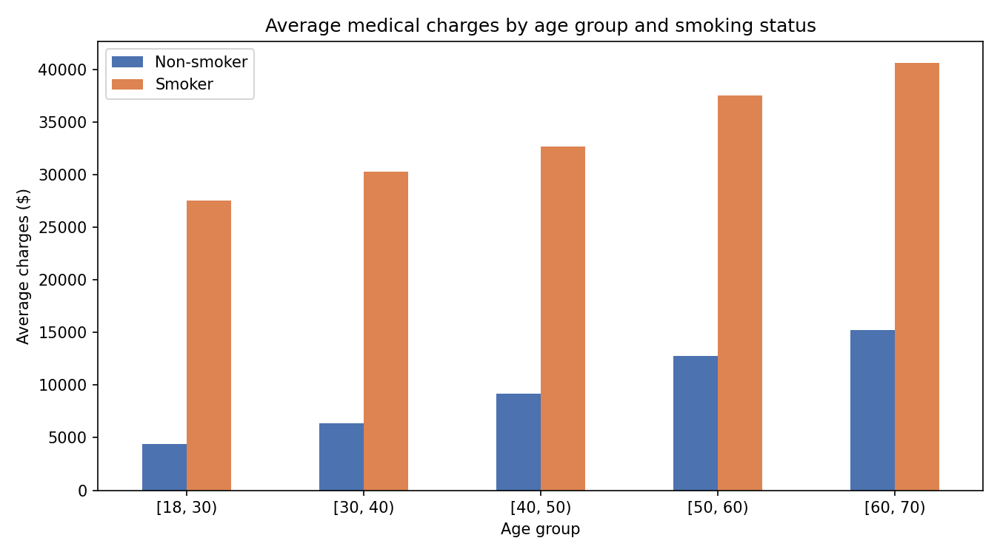
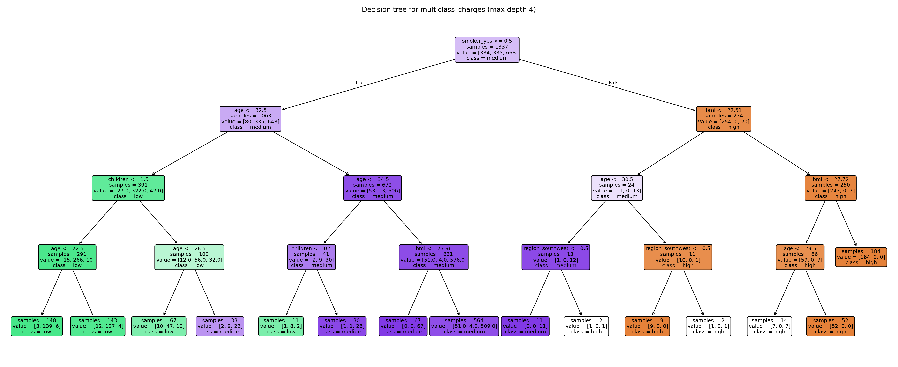
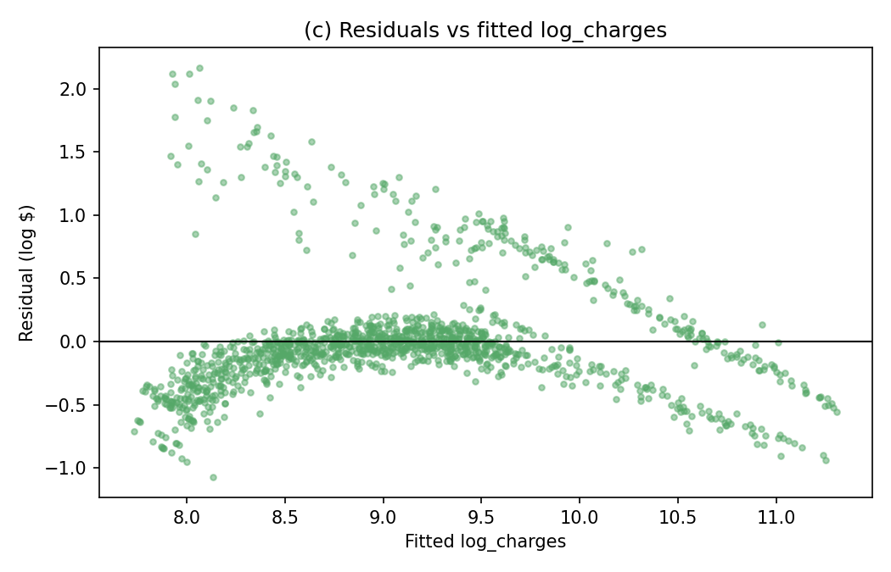

# Insurance charges regression

> Exploratory analysis, linear and logistic regression and a decision tree on the yearly medical charges of 1,337 insured people, to find what drives healthcare costs.


## TL;DR
- **Problem:** explain and predict yearly medical charges from age, gender, BMI, number of children, smoking status and US region.
- **Approach:** compare smokers and non-smokers by age group, fit linear regressions on charges and log(charges), a logistic regression on above-mean charges and a depth-4 decision tree on low/medium/high charges.
- **Result:** smoking dominates: smokers pay $23,100-25,400 more than non-smokers in every age group. On the log scale each extra year of age raises expected charges by about 3.5%, and the model explains 76.6% of the variance (adjusted R²).
- **Stack:** Python, pandas, statsmodels, scikit-learn, matplotlib, seaborn, Jupyter.

## Demo




## Data
`insurance.csv`: 1,337 people, 7 columns (age, gender, bmi, children, smoker, region, charges), no missing values.
The dataset is provided by the course BM04BIM Big Data Management and Analytics (RSM, Erasmus University Rotterdam) and is not included in this repository. Place it in `data/insurance.csv`.

## Approach
1. Average charges of smokers and non-smokers in five age groups, and a correlation matrix of the numerical variables.
2. Linear regression of charges on all predictors, with dummy variables for gender, smoker and region (references: female, no, northeast), and residual checks.
3. The same regression on `log_charges`, its residual checks, R² and predictions for five new people.
4. Logistic regression on `binary_charges` (1 if charges are above the mean of $13,279).
5. Decision tree (max depth 4) on `multiclass_charges`: low up to the first quartile, high above the third quartile, medium in between.

All steps are in [notebooks/insurance_regression.ipynb](notebooks/insurance_regression.ipynb).

## Results
| Model | Target | Fit | Significant predictors (p < 0.05) |
|---|---|---|---|
| Linear regression | charges | adj. R² 0.749 | age, bmi, children, smoker, region (southeast, southwest) |
| Linear regression | log_charges | adj. R² 0.766 | age, bmi, children, smoker, gender, region (southeast, southwest) |
| Logistic regression | binary_charges | pseudo R² 0.545 | age, smoker, region (southwest) |
| Decision tree | multiclass_charges | 15 leaves | first split on smoker, then age and bmi |

Being a smoker adds $23,847 to the expected charges in the linear model, while age is the numerical variable most correlated with charges (0.298). The residuals of both linear models are skewed and show separate bands, so the normality and homoscedasticity assumptions do not fully hold, even after the log transformation.



## How to run
```bash
git clone https://github.com/Mturco3/insurance-charges-regression.git
cd insurance-charges-regression
python -m venv .venv
.venv\Scripts\activate
pip install -r requirements.txt
# put insurance.csv in data/
jupyter nbconvert --to notebook --execute --inplace notebooks/insurance_regression.ipynb
```
Figures are saved to `Images/`.

## Project structure
```
├── data/                      # insurance.csv (not tracked)
├── notebooks/
│   └── insurance_regression.ipynb
├── Images/                    # figures saved by the notebook
├── requirements.txt
└── README.md
```

## Limitations and next steps
- All models are fit and described on the full dataset as the assignment asks; there is no train/test split, so the fits are in-sample and not a measure of predictive accuracy.
- The banded residuals suggest an interaction between smoking and BMI that the additive models leave out.

## Authors
Michele Turco

## License
Coursework for BM04BIM at RSM, Erasmus University Rotterdam. The dataset belongs to the course and is not redistributed.
